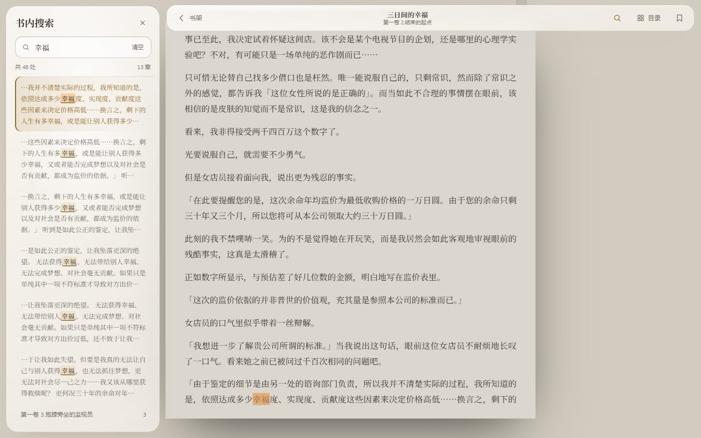

<div align="center">

# EBOOK

**轻小说与漫画阅读器** · iPhone / 安卓 / Windows / 网页

[下载最新版](https://github.com/shihshdh/ebook/releases/latest) · [运行与打包](docs/BUILD.md)

</div>


## 下载

| 平台 | 文件 | 安装与更新 |
|---|---|---|
| iPhone（iOS 15 及以上） | [EBOOK_0.4.1_ios-unsigned.ipa](https://github.com/shihshdh/ebook/releases/download/v0.4.1/EBOOK_0.4.1_ios-unsigned.ipa) | 用 SideStore 安装，见下方「iPhone 安装」 |
| 安卓 | [EBOOK_0.4.1.apk](https://github.com/shihshdh/ebook/releases/download/v0.4.1/EBOOK_0.4.1.apk) | 直接安装；以后在应用里「检查更新」 |
| Windows 10 / 11 | [EBOOK_0.4.1_x64-setup.exe](https://github.com/shihshdh/ebook/releases/download/v0.4.1/EBOOK_0.4.1_x64-setup.exe) | 直接安装；以后在应用里「检查更新」 |

> Windows 第一次运行如果提示「Windows 已保护你的电脑」，点「更多信息 → 仍要运行」。

### iPhone 安装

EBOOK 不在 App Store 上架，iPhone 版是**未签名的 IPA**，要用 [SideStore](https://sidestore.io/) 以你自己的 Apple 账号签名后安装：

1. 按 SideStore 的[前置条件](https://docs.sidestore.io/docs/installation/prerequisites)和[安装步骤](https://docs.sidestore.io/docs/installation/install)，在 iPhone 上装好 SideStore。
2. 下载上表里的 IPA，存到 iPhone 的「文件」App。
3. 打开 SideStore →「My Apps」→ 右上角「+」，选中这个 IPA，等签名安装完成。
4. 免费 Apple 账号的签名 7 天过期，要在 SideStore 里刷新（可以设置成后台自动刷新）。
5. 出新版时，按同样的步骤导入新的 IPA，**直接覆盖安装**，不要先卸载旧版，书架和阅读记录才能保留。iPhone 版不走应用内的「检查更新」。

## 功能

- **漫画**：随包 38 个漫画源，新账户默认开启 24 个，旧账户升级自动补入新增源；高分神作推荐、统一搜索、条漫 / 翻页阅读和书架进度。

- **书库**：轻小说文库约 4300 本（插图版按卷下载）、427 本中文公版古籍（简体 / 繁体），也可以导入本地 TXT / EPUB。
- **推荐**：近几年的口碑佳作，偏文笔细腻的作品；按奇幻、校园、科幻、恋爱、悬疑分区；首页还有 16 本「书源里的好书」，点开按书名和作者搜索。
- **阅读器**：分页 / 滚动、四种纸张、宋体 / 楷体（随包附带，离线可用）/ 黑体、划线笔记、书内全文搜索。
- **书架**：继续阅读、阅读统计、筛选排序，笔记可以导出成 Markdown。
- **书源**：内置 209 个通过静态规则检查的文字书源，也能导入 Legado（阅读 App）书源；网站现在能不能用，可以在书源页「测一遍」。
- **统一搜索**：文库和书源用同一个搜索池，同名且作者一致的结果合并显示，详情里保留各来源的下载入口。
- **书源审核与订阅**：书源只收文字书，订阅只收阅读内容；导入和读取旧数据时，会过滤掉成人、影音、漫画、软件工具这类来源。

## 截图


| 首页 · 细腻之选 | 探索 · 题材分区 |
|---|---|
|  |  |
| **详情 · 插图版按卷下载** | **阅读器 · 书内搜索** |
|  |  |


## 开发

```bash
npm install
npm run dev              # 网页预览 http://localhost:5180
npm run desktop:build    # Windows 安装包
```

安卓打包和签名、iPhone 的云端构建，都写在 [docs/BUILD.md](docs/BUILD.md)。

## 说明

EBOOK 本身不存放任何书籍内容：书目来自 [mojimoon/wenku8](https://github.com/mojimoon/wenku8) 和 Project Gutenberg 的公开数据，或者你自己导入。请支持正版。
