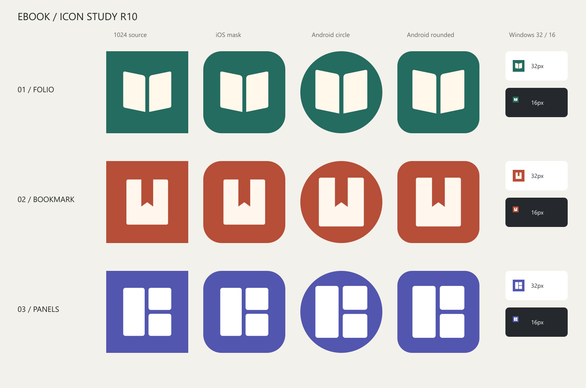

# EBOOK 图标 R10

2026-10-17 · 工作区 librarium-icon · 分支 feat/new-icon

## 设计原则：页间

用两个面与一道留白建立阅读的识别，不加入文字、装饰线或光影。几何必须经过细致校准，让符号在大画布与任务栏中拥有同样稳定的重心。

颜色以纯色承载识别，符号只用一种浅色。松绿与纸白带来明快的纸页感，避免夜空、月牙、暖黑与金色的夜读意象。

尺度服从阅读距离。正式图形宽 600 / 1024（58.6%），中心页缝 48 / 1024；以面替代细描边，16px 时仍保留可辨认的双页结构。曲线转折细致校准，形成统一的圆润语汇。

左右对称带来安定，向外展开的页缘表达翻阅。借鉴 Claude / ChatGPT 的两色、单符号与充足留白风格，所有图形均为原创几何，不使用其标志。

## 三个方案与平台预览

第一列是 1024 源图的缩略展示；末列为原生像素大小的 32px（浅底）与 16px（深底）。iOS 为近似系统圆角矩形；Android 展示真实 108dp 前景在 72dp 可视窗口内的圆形与圆角方形裁切。蒙版为离线视觉模拟，未进行真机安装验收。

| 方案 | 配色 | 含义与取舍 |
| --- | --- | --- |
| A · 翻页 FOLIO（正式） | 松绿 #246B60 / 纸白 #FFF8EB | 小说书页与漫画跨页的共同轮廓；单一双页符号，16px 的中缝仍可辨认。 |
| B · 书签 BOOKMARK | 陶红 #B64E38 / 浅白 #FFF7ED | 书签负形适合表达收藏，但容易被理解为保存工具。 |
| C · 分格 PANELS | 鸢尾紫 #5256AE / 白 #FFFFFF | 漫画分格明确，但更接近布局工具，小说语义较弱。 |

### 1024 × 1024 原图

## 正式资源与生成

选 A：阅读语义最直接，对小说与漫画都适用。SVG 满版纯色底，不预先切圆角；交由系统蒙版处理。favicon 使用同一符号。

Android 透明前景以中心缩放 0.72 输出到 108dp 画布，图形宽约 45.56dp；逐像素验证所有可见内容均在中央直径 66dp 安全圆内。底色同步到 make-icons.mjs、ios-assets.mjs 和 Android 原生颜色资源。

执行：

1. `node docs/icon-r10/generate.mjs`：生成三套源图、1024 PNG、16/32 PNG、对比图与正式 SVG。
2. `node scripts/make-icons.mjs`：生成正式 Android 各密度与桌面源图。
3. `npx tauri icon src-tauri/app-icon.png`：生成 PNG、ICO、ICNS、Windows Appx 和额外移动端尺寸。
4. 执行 `ios-assets.mjs` 中的 sharp 图标生成段（1024、flatten #246B60），没有执行修改 Xcode 版本号的段落。
5. 将正式 Android mipmap PNG 同步到 Tauri 生成的 `src-tauri/icons/android/mipmap-*` 副本，覆盖 Tauri 默认的透明圆角输出，统一底色与安全区。
6. `node docs/icon-r10/verify.mjs`：检查并输出 [逐文件结果](icon-r10/validation.txt)。

## 验证与范围

- 69 项图标输出检查通过：PNG 尺寸与命名吻合；完整图标底色不透明；Android 前景在 66dp 安全圆内；ICO 含 16/32 尺寸，ICNS 头与长度正确。
- Android：48/72/96/144/192px 图标与圆形图标；108/162/216/324/432px 自适应前景。
- 桌面：1024 源图，32/64/128/256/512 PNG、Windows 各尺寸、ICO、ICNS。Tauri 附加 iOS 20–1024px 系列也已生成。
- 实际 iOS Asset Catalog 使用 universal 1024 图标，与现有 Contents.json 一致，底色不透明。
- 对比图人工检查通过：圆角与圆形裁切没有截断符号，16px 保留书页与中缝。
- `npm run build` 通过（9.28s）。Vite 有现有混合静态/动态导入及大 chunk 提示，不影响构建成功。
- 修改仅限本工作区图标资源、生成脚本、图标预览文档与任务书要求的 ASTRA_REPORT 摘要。没有修改业务代码、Xcode 项目或其他工作区。
- 本地提交到 feat/new-icon；不推送、不合并、不发版。

完成
