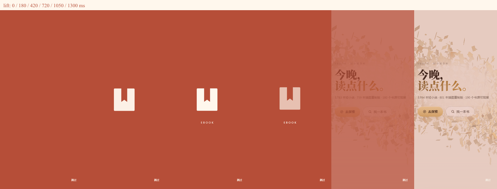
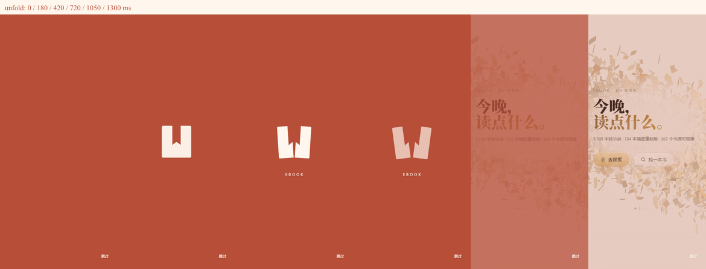

# R12 · 陶红书签开屏

2026-10-17 · librarium-splash · feat/new-splash

## 两个方向

A「书签轻提」（正式版）：原图同款书签从 12px 下方淡入，短暂停留，上提 16px 淡去；陶红表面连续退去，露出已经在背后加载的首页。少量无衬线 EBOOK 小字作为辅助，不等字体，不把书签变成字标。手机上原有顶栏隐藏，因此取消旧版字标飞入，不引入不存在的落点。总时间 1400ms。

B「书页展开」：同一书签从中间分成两个面，各向外移动并旋转 8°，形成翻开书页的动作，再退到首页。同样 1400ms。语义更明显，但拆开后的符号识别弱于 A，因此选 A。

截图从左到右为 0 / 180 / 420 / 720 / 1050 / 1300ms，视口 390×844。原尺寸逐帧 PNG 同目录。截图是实际 React 开屏 CSS 动画的确定性采样，暂停动画并设置 currentTime；截图专用页面禁用 1400ms 清理计时器，行为和性能验证使用全新上下文，不禁用计时器。不是实时时长录像。

切换：修改 `src/components/Splash.jsx` 的 `SPLASH_DIRECTION`，`lift` 为 A，`unfold` 为 B。无需改 CSS 或平台配置。

## 三段衔接

| 阶段 | 浅色 | 深色 / 跟随系统深色 | 图标与位置 |
| --- | --- | --- | --- |
| Android 系统启动页 | #B64E38 | #B64E38 | 透明图标，纯品牌底 |
| iOS LaunchScreen | #B64E38 | #B64E38 | 无图标，纯品牌底 |
| Capacitor 窗口 / 网页首帧 | #B64E38 | #B64E38 | 内联遮罩，React 前为空白 |
| React 开屏首帧 | #B64E38 | #B64E38 | 中央 192×192 SVG 初始透明 |
| 开屏展示 | #B64E38 + #FFF7ED | 同左 | 与 public/app-icon.svg 完全相同路径 |
| 开屏退场 → 首页 | 淡至当前浅色首页 | 淡至当前深色首页 | 标志先淡去，背景只降低 opacity |

原生统一使用纯色启动页，是主动的交接设计：不让 Android 系统图标安全区和 iOS 不同尺寸启动图与网页图标硬对齐。书签仅在网页出现；原生与网页切换时都没有可跳动的图标。主题在 index.html 现有同步脚本中提前确定，开屏独立使用品牌色，无渐变、夜空、月牙、金线或手写字。网页初始遮罩在 Splash 布局 effect 中撤掉；不播开屏的锁屏/阅读分支由 root 挂载后的 CSS 选择器撤掉遮罩。首页一直照常挂载加载。

Android/iOS 仅静态检查配置，没有启动模拟器或真机，不能据此宣称原生无闪验收通过。Android 12 使用透明 ColorDrawable 作为启动图标；仍需设备确认 OEM 行为。未启动 Tauri 或桌面客户端。

## 行为与构建

- 浏览器服务：`npm run dev -- --port 5190 --strictPort`。
- 独立无头 Edge，390×844，浅色 / 深色 / 跟随系统深色均为 rgb(182,78,56)，CSS 时长 1.4s。
- prefers-reduced-motion：只淡入淡出，0.5s，无位移、缩放或旋转。
- 点击 / 任意键立即结束；三种主题、减少动态、键盘跳过、按钮跳过均写入 sessionStorage 的 librarium.splash=1，同会话刷新不再播放。
- 原有后台画布 worker 已删除。开屏只动画 transform / opacity，不依赖字体、网络或逐帧 JavaScript。表面在 1400ms 后保持 opacity:0；即使主线程忙、清理回调延迟，也不会再次盖回首页。
- `npm run build` 通过（Vite 5.4.21，315 modules）；现有 native.js 静态/动态混合引用及大 chunk 提示仍在。
- 验证脚本：`node docs/verify-splash-r12.mjs`；需当前机器运行时提供的 Playwright / Sharp 和 Edge。结果见 [verification.json](screenshots/splash-r12/verification.json)。

## 4× CPU 录帧结果与未通过项

在真实首页加载路径单独采集 requestAnimationFrame 时间戳，不同时录截图。3 次热缓存导航的结果如下：

| 次数 | 采样间隔数 | 最大主线程帧间隔 | >33ms 间隔数 | DOM 从出现到清理 |
| --- | ---: | ---: | ---: | ---: |
| 1 | 8 | 1093.3ms | 7 | 1867.1ms |
| 2 | 8 | 1060.0ms | 6 | 1782.7ms |
| 3 | 10 | 830.0ms | 8 | 1767.8ms |

**整页性能要求未通过**：不能宣称「手机 4× CPU 无超过 33ms 帧」。这些是主线程 rAF 间隔，不是合成线程实际呈现间隔，不能据此断言书签动画本身卡住。首页加载与开屏共存时存在明显长任务；本轮尚未定位其来源。视觉动画时间线为 1400ms，但 DOM 清理在压力下晚于 1600ms。当前改动范围不允许调整 App / 首页 / 书库加载，故保留诚实的未通过记录，不用推迟首页加载来掩盖。后续需另行处理启动长任务并以真实设备合成帧复核，才能完成严格性能验收。

## 范围与交付

只修改开屏组件、开屏 CSS、首帧内联样式、启动底色/原生启动样式及本轮文档/截图。没有修改导航功能或任何其他工作区。提交到 feat/new-splash；不推送、不合并、不发版。

完成
